# cookit

LLM(Gemini) 기반 레시피 추천 서비스 cookit을 Spring Boot + React로 개발해 온프레미스 가상화 환경에 단일 구성(VM 4대)으로 구축한 뒤, HTTPS 적용과 고가용성(HA) 이중화(VM 7대)로 고도화하고 통합 모니터링·무중단 배포(CI/CD)까지 구축·운영하는 인프라 프로젝트

> 진행 상태: 설계 완료, 개발·구축 진행 예정

## 단계 구성

| 단계 | 구성 | 주요 내용 |
|---|---|---|
| 1단계 단일 구성 | VM 4대 (LB·WAS·DB·모니터링), HTTP | 서비스 개발, Ansible 자동화, CI/CD 자동 배포, 모니터링·알림 |
| 2단계 HTTPS 적용 | VM 4대 | Let's Encrypt 인증서 자동 갱신, 80 → 443 리다이렉트, 인증서 만료 알림 |
| 3단계 이중화 | VM 7대 | LB(keepalived VIP)·WAS·DB(Galera) 이중화, 롤링 무중단 배포, 장애 테스트 |

## 구성도

**1단계 단일 구성**



**3단계 이중화 구성**



## 기술 스택

| 구분 | 기술 |
|---|---|
| 애플리케이션 | Java 21, Spring Boot 4.2, React + Vite (TypeScript), Google Gemini |
| 웹·로드밸런서 | Nginx, keepalived, Let's Encrypt (certbot) |
| 데이터 | MariaDB 11.4 + Galera Cluster, HAProxy, Redis |
| 모니터링·알림 | Prometheus, Grafana, Loki, Grafana Alloy, Alertmanager, Slack |
| 자동화·배포 | Ansible, GitHub Actions, GHCR, Self-hosted Runner, Docker |
| 서버 | CentOS Stream 9 (온프레미스 가상화 환경) |
| 테스트 | JUnit 5, Testcontainers, k6 |

## 저장소 구조

```
cookit/
├── backend/            Spring Boot API 서버
├── frontend/           React 화면
├── infra/
│   ├── ansible/        서버 구성 자동화 (inventory, roles, playbooks)
│   └── docker/         WAS·모니터링 서버용 compose 파일
├── load-test/          k6 부하 테스트 스크립트
├── docs/               단계별 설계·구축·운영 문서
└── .github/workflows/  CI·배포
```

## 문서

| 단계 | 문서 |
|---|---|
| 00 | [프로젝트 개요](docs/00-project-overview.md) |
| 01 | [요구사항](docs/01-requirements.md) |
| 02 | [아키텍처 설계](docs/02-architecture.md) |
| 03 | [기술 스택](docs/03-tech-stack.md) |
| 04 | [상세 설계](docs/04-detailed-design.md) |
| 05 | [개발 환경](docs/05-dev-environment.md) |
| 06 | [인프라 구축](docs/06-infra-build.md) |
| 07 | [애플리케이션 개발](docs/07-app-dev.md) |
| 08 | [CI/CD](docs/08-cicd.md) |
| 09 | [테스트](docs/09-test.md) |
| 10 | [운영·회고](docs/10-operations.md) |

## 결과

단계별 테스트 완료 후 작성 (장애 전환 시간, 가용성, 부하 테스트 결과, 1단계와 3단계 비교)
