# 02. 아키텍처 설계

> 단일 구성(1단계) → HTTPS 적용(2단계) → 이중화(3단계) 순서로 고도화

※ 사설 IP(192.168.10.x)는 예시이며 실제 내부 할당 값으로 변경 예정. 공인 IP는 보안상 문서에 기재하지 않음.

## 1단계 · 단일 구성 (VM 4대, HTTP)

### 요청 흐름

1. 접속: 사용자 → 가비아 DNS → 공인 IP → 방화벽 NAT → LB1 `192.168.10.101`
2. 화면 요청(/): LB1 Nginx가 React 빌드 파일로 직접 응답
3. API 요청(/api): LB1이 WAS1로 전달
4. 레시피 추천: WAS1이 Redis 캐시 조회 후 있으면 바로 응답, 없으면 Gemini API 호출 후 결과를 Redis(캐시)·DB(레시피·검색 기록)에 저장 및 응답
5. 그 외 API(회원·내 재료·즐겨찾기·검색 기록): WAS1 내 HAProxy를 거쳐 DB1 조회·저장
6. 추천 요청 횟수 제한·인기 랭킹: Redis에서 처리

### 장애 영향 (단일 장애점)

| 구간 | 장애 시 |
|---|---|
| LB | 서비스 전체 중단 |
| WAS | 화면은 표시, API 전체 실패 |
| DB | 회원·내 재료·즐겨찾기 등 DB 기능 실패, 캐시된 추천만 응답 |
| Redis | 추천은 캐시 없이 매번 Gemini 호출(응답 지연), 요청 횟수 제한 미적용(허용), 인기 랭킹 영역 숨김 |
| 모니터링 서버 | 서비스 유지, Redis도 같은 서버라 Redis 장애와 동일 영향, 모니터링·알림·배포 중단 (서버 다운은 외부 생존 신호 확인으로 감지) |
| Gemini API (외부) | 30초 타임아웃 후 사용자 안내 메시지 표시, 캐시된 추천은 정상 응답 |
| 배포 | 컨테이너 재시작 동안 API 중단 |

### 이중화 대비 설계 (1단계부터 적용)

1. 외부 진입: 공인 IP NAT로 고정, 3단계에서 NAT 대상만 LB1 → VIP로 변경 (DNS 변경 없음)
2. LB: Nginx upstream(WAS 목록)으로 WAS 연결, 3단계에서 WAS2 주소만 추가
3. WAS 상태 비저장(Stateless): 로그인은 JWT, 캐시·요청 횟수·랭킹은 Redis에 저장해 어느 WAS로 요청이 가도 동일 동작
4. WAS 헬스체크: `/actuator/health` 제공, 3단계 롤링 배포·장애 감지에 사용
5. DB 접속: 앱은 WAS 내 HAProxy(`localhost:3306`)로만 접속, 3단계에서 HAProxy에 DB2를 대기(backup)로 추가 (앱 설정 변경 없음)
6. DB: MariaDB 11.4 사용 (Galera 내장), 3단계에서 Galera 설정만 활성화
7. 자동화: Ansible inventory·배포 스크립트를 서버 목록 기준으로 작성, 3단계에서 서버만 추가

## 2단계 · HTTPS 적용 (VM 4대)

### 변경 사항

1. 서버 구성은 1단계와 동일, 접속 주소만 `https://cookit.neurondev.co.kr`
2. 방화벽 NAT: 공인 IP 80·443 → LB1, LB1 서버 방화벽(firewalld)에 443 추가
3. LB1 Nginx에서 HTTPS 처리(TLS 종료), LB1 → WAS 구간은 서버망 내부라 HTTP 유지
4. 원래 요청이 HTTPS였음을 WAS에 전달 (`X-Forwarded-Proto`)
5. 80 접속은 443으로 리다이렉트 (인증서 갱신용 `/.well-known/acme-challenge` 경로는 제외)
6. blackbox_exporter 확인 주소를 https로 변경, 인증서 만료일 수집
7. 만료 14일 전 warning, 3일 전 critical 알림 (Slack)

### 인증서 발급·갱신 (90일 유효)

1. 발급: LB1에서 certbot(인증서 발급 프로그램) 실행 → 확인용 파일 생성 → Let's Encrypt가 공인 IP 80으로 접속해 파일 확인 → 도메인 소유 확인 후 발급
2. 자동 갱신: certbot 설치 시 함께 등록되는 예약 작업(systemd timer)이 만료 30일 이내면 자동 재발급
3. 적용: 갱신 직후 Nginx reload(중단 없이 설정 재적용)가 자동 실행되도록 설정 (deploy hook)
4. 실패 대비: 모니터링이 만료일을 따로 확인, 14일 전·3일 전 Slack 알림 후 수동 갱신

## 3단계 · 이중화 구성 (VM 7대, HTTPS)

### 전환 작업 (2단계 → 3단계)

1. VM: 3대 추가 생성 (lb02, was02, db02), Ansible로 기본 설정
2. LB: LB1·LB2에 keepalived(서로 생존 확인, 장애 시 VIP 자동 이동) 설치, VIP `192.168.10.100` 구성 (LB1 MASTER, LB2 BACKUP)
3. 진입: 방화벽 NAT 대상을 LB1 → VIP로 변경 (DNS 변경 없음)
4. 인증서: 갱신은 LB1에서만 수행, 모니터링 서버가 매일 인증서 동기화 playbook을 자동 실행해 LB2에 복사. VIP가 LB2에 있을 때 들어온 갱신 확인 요청은 LB2가 LB1로 전달
5. WAS: WAS2 추가 후 Nginx upstream에 등록, 배포 방식을 롤링(1대씩 교체)으로 변경
6. DB: DB1에서 Galera 활성화 → DB2 합류(데이터 자동 복사, SST) → 모니터링 서버에서 garbd(투표 전용, 데이터 없음) 실행 → HAProxy에 DB2를 대기(backup)로 추가
7. 검증: 장애 테스트 수행, 1단계 기준값과 중단 시간 비교

### 요청 흐름

1. 접속: 사용자 → 가비아 DNS → 공인 IP → 방화벽 NAT → VIP `192.168.10.100` → VIP를 보유한 LB1 (HTTPS 처리)
2. 화면 요청(/): LB1 Nginx가 React 빌드 파일로 직접 응답
3. API 요청(/api): LB1이 WAS1·WAS2에 라운드로빈 분배, 장애 WAS는 제외
4. 레시피 추천: WAS가 Redis 캐시 조회 후 있으면 바로 응답, 없으면 Gemini API 호출 후 결과를 Redis(캐시)·DB(레시피·검색 기록)에 저장 및 응답
5. 그 외 API(회원·내 재료·즐겨찾기·검색 기록): WAS 내 HAProxy를 거쳐 DB1에서 읽기·쓰기, Galera가 DB2에 즉시 동기 복제
6. 추천 요청 횟수 제한·인기 랭킹: Redis에서 처리, WAS1·WAS2가 같은 Redis 공유

### 이중화와 장애 대응

| 구간 | 방식 | 장애 시 |
|---|---|---|
| LB | Active-Standby (1대 대기) | LB1 서버 또는 Nginx 장애 시 keepalived가 약 3초 내 VIP를 LB2로 이동 |
| WAS | Active-Active (2대 동시 처리) | Nginx가 응답 실패한 WAS를 일정 시간 제외, 남은 1대가 처리 |
| DB | Active-Standby (쓰기 1대, 1대 대기) | HAProxy 헬스체크로 DB1 장애 감지 시 DB2로 자동 전환, DB2와 garbd로 과반(3표 중 2표) 유지해 쓰기 계속. DB1 복구 시 자동 재합류 후 복귀 |
| Redis | 단일 | 추천은 캐시 없이 매번 Gemini 호출(응답 지연), 요청 횟수 제한 미적용(허용), 인기 랭킹 영역 숨김 |
| 모니터링 서버 | 단일 | 서비스 유지, Redis 장애와 동일 영향, 모니터링·알림·배포 중단 (서버 다운은 외부 생존 신호 확인으로 감지). garbd도 중단되나 DB 2대로 과반 유지 |
| Gemini API | 외부 | 30초 타임아웃 후 사용자 안내 메시지 표시, 캐시된 추천은 정상 응답 |

**비고**

1. Galera는 양쪽 쓰기(A-A)가 가능하나, 동시 수정 충돌·롤백 방지를 위해 쓰기는 DB1 1대로 운영
2. VM 7대가 같은 호스트 서버에서 실행되어 호스트 장애·방화벽 장애는 이중화 범위 밖 (한계)

## 공통 · 모니터링·로그·백업 (전 단계)

1. Prometheus가 전체 서버 지표 수집 (15초 간격)
2. Grafana Alloy가 전체 서버 로그를 Loki로 전송, 요청 ID로 LB → WAS 구간 추적
3. blackbox_exporter가 서비스 도메인 접속 확인 (평시 15초, 장애 테스트 중 1초 간격), 2단계부터 인증서 만료일 확인 (3단계는 LB2 인증서도 따로 확인)
4. Alertmanager가 critical·warning 모두 Slack으로 전송
5. 모니터링 서버 자체 장애 대비: 항상 켜져 있는 알림(Watchdog)을 5분마다 외부 무료 서비스(healthchecks.io)로 전송, 신호가 끊기면 외부 서비스가 Slack으로 알림
6. DB 백업은 매일 새벽 mariabackup으로 생성해 모니터링 서버에 7일 보관, 3단계부터는 대기 DB2에서 백업해 운영 DB(DB1) 부하 방지

---

이전 문서: [01. 요구사항](01-requirements.md) · 다음 문서: [03. 기술 스택](03-tech-stack.md)
