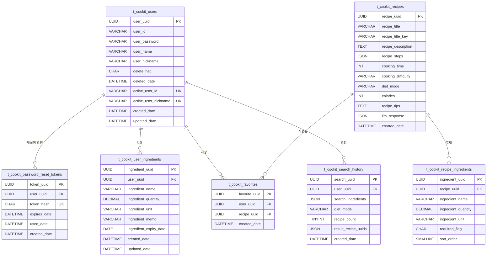

# DB 설계 (ERD·컬럼 정의서)

> 04 상세 설계 > 13. 테이블 기준, Flyway 첫 마이그레이션(`V1`)으로 사용

## 1. ERD

## 2. 공통 규칙

| 구분 | 규칙 |
|---|---|
| 이름 | 테이블 `t_cookit_` 접두어, 컬럼 소문자 + 밑줄(snake_case). 기본 키는 `대상_uuid`(예: `user_uuid`), 일반 컬럼은 대상 접두어(예: `recipe_title`) |
| 기본 키 | MariaDB `UUID` 형식 (16바이트 저장, 조회 시 문자열 표시), 앱에서 UUID v7(시간 순서 UUID) 생성 → 새 데이터가 인덱스 끝에 추가되어 저장 성능 유지 |
| 엔진·문자셋 | InnoDB, `utf8mb4` (`utf8mb4_unicode_ci`), 테이블·컬럼마다 설명(`COMMENT`) 작성 |
| 일시 | `DATETIME` (Asia/Seoul 기준). `created_date` 기본값 현재 시각, `updated_date`는 수정 시 DB가 자동 갱신(`ON UPDATE CURRENT_TIMESTAMP`) |
| 여부 값 | `CHAR(1)` `Y`/`N` (예: `delete_flag`, `required_flag`) |
| 코드 값 | 영문 대문자 코드로 저장, 화면 표시명은 앱에서 변환 (예: `BALANCE` → 밸런스) |
| 외래 키 | 실제 외래 키 제약 사용, 삭제는 제한(`RESTRICT`) |
| 인덱스·제약 이름 | 고유 `ux_테이블_컬럼`, 일반 `ix_테이블_컬럼`, 외래 키 `fk_테이블_참조테이블` (예: `fk_favorites_users`) |
| 삭제 | 회원만 소프트 삭제(`delete_flag`), 나머지는 실제 삭제 |

## 3. 코드 값

| 구분 | 코드 (표시명) |
|---|---|
| 식단 모드 (`diet_mode`) | `BALANCE`(밸런스), `DIET`(다이어트), `QUICK`(초간단) |
| 난이도 (`cooking_difficulty`) | `EASY`(쉬움), `NORMAL`(보통), `HARD`(어려움) |
| 재료 단위 (`ingredient_unit`) | `EA`(개), `G`(g), `KG`(kg), `ML`(ml), `L`(L), `TBSP`(큰술), `TSP`(작은술), `CUP`(컵), `SHEET`(장), `CLOVE`(쪽), `HANDFUL`(줌), `PINCH`(꼬집), `LITTLE`(약간), `PROPER`(적당량) |

- 코드 목록은 앱 코드(Java enum)에서 관리, DB에는 코드만 저장
- 프론트는 `GET /api/v1/codes`로 코드·표시명 목록을 받아 사용 (목록을 백엔드 한 곳에서만 관리)
- `LITTLE`(약간)·`PROPER`(적당량)은 수량 없이 단위만 저장
- Gemini 응답도 같은 단위 코드로 받도록 응답 형식 지정, 목록에 없는 단위는 `PROPER`로 저장

## 4. 컬럼 정의서

### t_cookit_users (회원)

| 컬럼 | 형식 | NULL | 기본값 | 설명 |
|---|---|---|---|---|
| user_uuid | UUID | N |  | 기본 키 |
| user_id | VARCHAR(20) | N |  | 로그인 아이디 (영문 소문자·숫자 4~20자) |
| user_password | VARCHAR(255) | N |  | 비밀번호 해시 (BCrypt) |
| user_name | VARCHAR(50) | Y |  | 이름 (아이디·비밀번호 찾기 본인 확인용, 탈퇴 시 삭제) |
| user_nickname | VARCHAR(10) | N |  | 닉네임 (2~10자, 특수문자 불가) |
| delete_flag | CHAR(1) | N | `N` | 탈퇴 여부 (`Y` 탈퇴) |
| deleted_date | DATETIME | Y |  | 탈퇴 일시 |
| active_user_id | VARCHAR(20) | Y | 자동 계산 | 탈퇴 전이면 `user_id`, 탈퇴 후 NULL (DB 저장형 자동 계산 컬럼, `PERSISTENT`) |
| active_user_nickname | VARCHAR(10) | Y | 자동 계산 | 탈퇴 전이면 `user_nickname`, 탈퇴 후 NULL (`PERSISTENT`) |
| created_date | DATETIME | N | 현재 시각 | 가입 일시 |
| updated_date | DATETIME | N | 현재 시각 | 수정 일시 |

- 인덱스: `ux_users_active_user_id`(active_user_id), `ux_users_active_user_nickname`(active_user_nickname)
- 탈퇴 회원의 아이디·닉네임은 다시 사용 가능: 고유 규칙은 자동 계산 컬럼(`active_*`)에만 적용, NULL끼리는 중복으로 보지 않음
- 로그인·중복 확인·아이디 찾기는 `delete_flag = 'N'` 회원만 조회
- 자동 계산 컬럼은 DB가 값을 채우므로 앱(JPA)에서는 읽기 전용으로 설정 (값을 넣으면 오류)
- 탈퇴 시 이름(실명)만 삭제, 아이디·닉네임은 이력 확인용으로 유지. 추후 게시판 등 작성자가 보이는 기능은 탈퇴 회원을 "탈퇴한 회원"으로 표시

### t_cookit_password_reset_tokens (비밀번호 재설정 토큰)

| 컬럼 | 형식 | NULL | 기본값 | 설명 |
|---|---|---|---|---|
| token_uuid | UUID | N |  | 기본 키 |
| user_uuid | UUID | N |  | 회원 (FK → users) |
| token_hash | CHAR(64) | N |  | 재설정 토큰의 SHA-256 해시값 (DB 유출 대비, 토큰 값 대신 해시값을 저장) |
| expires_date | DATETIME | N |  | 만료 일시 (발급 후 15분) |
| used_date | DATETIME | Y |  | 사용 일시 (값이 있으면 사용 완료, 재사용 불가) |
| created_date | DATETIME | N | 현재 시각 | 발급 일시 |

- 인덱스: `ux_reset_tokens_token_hash`(token_hash), `ix_reset_tokens_user_uuid`(user_uuid)
- 새 토큰 발급 시 같은 회원의 사용하지 않은 이전 토큰은 무효 처리 (`used_date` 기록)
- 만료 후 하루 지난 토큰은 매일 정기 삭제 (앱 예약 작업, WAS 2대가 함께 실행해도 결과 동일)

### t_cookit_user_ingredients (내 재료)

| 컬럼 | 형식 | NULL | 기본값 | 설명 |
|---|---|---|---|---|
| ingredient_uuid | UUID | N |  | 기본 키 |
| user_uuid | UUID | N |  | 회원 (FK → users) |
| ingredient_name | VARCHAR(100) | N |  | 재료명 |
| ingredient_quantity | DECIMAL(10,2) | Y |  | 수량 (숫자만) |
| ingredient_unit | VARCHAR(20) | Y |  | 단위 코드 (3. 코드 값) |
| ingredient_memo | VARCHAR(200) | Y |  | 메모 (예: 냉동실, 빨리 먹기) |
| ingredient_expiry_date | DATE | Y |  | 유통기한 (모르면 비움) |
| created_date | DATETIME | N | 현재 시각 | 등록 일시 |
| updated_date | DATETIME | N | 현재 시각 | 수정 일시 |

- 인덱스: `ix_user_ing_user_expiry`(user_uuid, ingredient_expiry_date) → 회원별 목록 조회, 추후 유통기한 임박 표시

### t_cookit_recipes (추천 레시피)

| 컬럼 | 형식 | NULL | 기본값 | 설명 |
|---|---|---|---|---|
| recipe_uuid | UUID | N |  | 기본 키 |
| recipe_title | VARCHAR(200) | N |  | 레시피 제목 |
| recipe_title_key | VARCHAR(200) | N |  | 공백을 제거한 제목 (인기 랭킹 집계 기준) |
| recipe_description | TEXT | Y |  | 레시피 설명 |
| recipe_steps | JSON | N |  | 조리 단계 (문자열 배열) |
| cooking_time | INT | Y |  | 조리 시간(분) |
| cooking_difficulty | VARCHAR(20) | Y |  | 난이도 코드 |
| diet_mode | VARCHAR(20) | N |  | 식단 모드 코드 |
| calories | INT | Y |  | 칼로리(kcal) |
| recipe_tips | TEXT | Y |  | 팁 |
| llm_response | JSON | Y |  | Gemini 원본 응답 중 해당 레시피 부분 (문제 분석용, 한 번에 받은 레시피 여러 개가 중복 저장되지 않도록) |
| created_date | DATETIME | N | 현재 시각 | 생성 일시 |

- 인덱스: `ix_recipes_title_key`(recipe_title_key, created_date) → 랭킹 클릭 시 같은 제목의 최근 레시피 조회
- 추천마다 새로 저장, 수정·삭제 없음

### t_cookit_recipe_ingredients (레시피별 재료)

| 컬럼 | 형식 | NULL | 기본값 | 설명 |
|---|---|---|---|---|
| ingredient_uuid | UUID | N |  | 기본 키 |
| recipe_uuid | UUID | N |  | 레시피 (FK → recipes) |
| ingredient_name | VARCHAR(100) | N |  | 재료명 (내 재료와 이름으로 비교해 보유·부족 표시, 비교 시 공백 제거) |
| ingredient_quantity | DECIMAL(10,2) | Y |  | 수량 (숫자만) |
| ingredient_unit | VARCHAR(20) | Y |  | 단위 코드 |
| required_flag | CHAR(1) | N | `Y` | 필수 재료 여부 (`N` 선택 재료) |
| sort_order | SMALLINT | N | `0` | 표시 순서 |

- 인덱스: `ix_recipe_ing_recipe_uuid`(recipe_uuid)

### t_cookit_favorites (즐겨찾기)

| 컬럼 | 형식 | NULL | 기본값 | 설명 |
|---|---|---|---|---|
| favorite_uuid | UUID | N |  | 기본 키 |
| user_uuid | UUID | N |  | 회원 (FK → users) |
| recipe_uuid | UUID | N |  | 레시피 (FK → recipes) |
| created_date | DATETIME | N | 현재 시각 | 저장 일시 |

- 인덱스: `ux_favorites_user_recipe`(user_uuid, recipe_uuid) → 같은 레시피 중복 저장 방지, `ix_favorites_user_created`(user_uuid, created_date), `ix_favorites_recipe_uuid`(recipe_uuid)
- 해제 시 실제 삭제 (다시 저장하면 새로 추가)

### t_cookit_search_history (추천 요청 기록)

| 컬럼 | 형식 | NULL | 기본값 | 설명 |
|---|---|---|---|---|
| search_uuid | UUID | N |  | 기본 키 |
| user_uuid | UUID | N |  | 회원 (FK → users) |
| search_ingredients | JSON | N |  | 입력 재료 (문자열 배열) |
| diet_mode | VARCHAR(20) | N |  | 식단 모드 코드 |
| recipe_count | TINYINT | N |  | 추천 개수 |
| result_recipe_uuids | JSON | N |  | 추천 결과 레시피 UUID 목록 (캐시 응답도 같은 레시피 기록) |
| created_date | DATETIME | N | 현재 시각 | 요청 일시 |

- 인덱스: `ix_search_user_created`(user_uuid, created_date) → My Kitchen 최근 기록 순 조회
- 회원 요청만 저장 (비회원은 기록 화면이 없어 저장 안 함)

## 5. 데이터 흐름

| 동작 | 테이블 처리 |
|---|---|
| 추천 (캐시 없음) | recipes·recipe_ingredients 저장 + search_history 저장(회원), 하나의 트랜잭션 |
| 추천 (캐시 적중) | 캐시의 레시피 UUID로 응답, search_history만 저장(회원) |
| 인기 랭킹 클릭 | Redis의 제목 키(recipe_title_key)로 recipes에서 같은 제목의 최근 레시피 조회 |
| 회원 탈퇴 | users.delete_flag = `Y`, deleted_date 기록, user_name 삭제(NULL). 내 재료·즐겨찾기·검색 기록은 남겨 둠 (본인만 보는 데이터라 다른 사람에게 노출 없음) |
