# 화면 설계서

> 04 상세 설계 > 15. 화면 기준, 와이어프레임은 `docs/images/screens/`
> 그림의 주황색 번호는 각 화면 표의 번호와 같음

## 1. 화면 목록

| 번호 | 화면 | 경로 | 인증 | 요구사항 |
|---|---|---|---|---|
| 01 | 메인 (추천 전) | `/` | - | FR-08, 09, 14 |
| 02 | 메인 (추천 결과·상태) | `/` | - | FR-08, 09, 12 |
| 03 | 레시피 상세 팝업 | 팝업 | - | FR-10, 11 |
| 04 | 로그인 | `/login` | - | FR-02 |
| 05 | 회원가입 | `/signup` | - | FR-01 |
| 06 | 아이디 찾기 | `/find-id` | - | FR-03 |
| 07 | 비밀번호 찾기 | `/find-password` | - | FR-04 |
| 08 | 비밀번호 재설정 | `/reset-password` | - | FR-04 |
| 09 | My Kitchen > 내 재료 (+ 09-1 추가·수정 팝업) | `/my` | 회원 | FR-07 |
| 10 | My Kitchen > 즐겨찾기 | `/my` | 회원 | FR-11 |
| 11 | My Kitchen > 검색 기록 (+ 11-1 결과 팝업) | `/my` | 회원 | FR-12 |
| 12 | My Kitchen > 회원정보 | `/my` | 회원 | FR-05, 06 |
| 13 | 공통 요소 | - | - | FR-13 |
| M1~M3 | 모바일 (메인, 상세, My Kitchen) | - | - | - |

※ 인증 열의 "-"는 비회원도 사용 가능

## 2. 공통 규칙

| 구분 | 규칙 |
|---|---|
| 디자인 | 흰 배경, 진한 남색(`#111827`) 주요 버튼, 주황(`#f97316`) 포인트(로고 "it", 강조 숫자), 둥근 카드(그림자 약하게), 선택 항목은 회색 바탕 안의 흰 버튼(세그먼트) |
| 레이아웃 | 상단 헤더(가운데 로고, 오른쪽 My Kitchen·로그인 또는 닉네임·로그아웃), 하단 푸터(로고, `served by` 처리 WAS) |
| 인증 화면 | 로그인·회원가입·아이디/비밀번호 찾기·재설정은 헤더 없이 가운데 카드(로고 + 안내 문구)로 표시 |
| 화면 크기 | PC(너비 1000px 기준)·모바일(너비 375px 기준) 반응형, 모바일은 헤더 메뉴(☰)로 이동 |
| 코드 표시명 | 단위·식단 모드·난이도는 앱 시작 시 `GET /api/v1/codes`로 받아 표시 |
| 접근 제어 | 회원 전용 화면에 비회원 접근 시 로그인 화면으로 이동, 로그인 후 원래 화면으로 복귀 |
| 로그인 만료 | API가 401 응답 시 "로그인이 필요합니다" 안내 후 로그인 화면 이동 |
| 입력 규칙 | 아이디: 영문 소문자·숫자 4~20자 / 비밀번호: 8~20자, 영문·숫자 포함 / 닉네임: 2~10자, 특수문자 불가 / 추천 재료: 최대 10개 / 추천 개수: 1~5개(기본 3개) |
| 목록 | 즐겨찾기·검색 기록은 한 페이지 10개 (페이지 번호 방식), 내 재료는 전체 조회 후 화면에서 검색·정렬 |
| 안내 메시지 | 화면 위쪽에 3초 표시 (성공 초록, 오류 빨강, 안내 파랑) |
| 삭제·탈퇴 | 확인 팝업 후 실행 |

## 3. 화면별 설계

### 01. 메인 (추천 전)

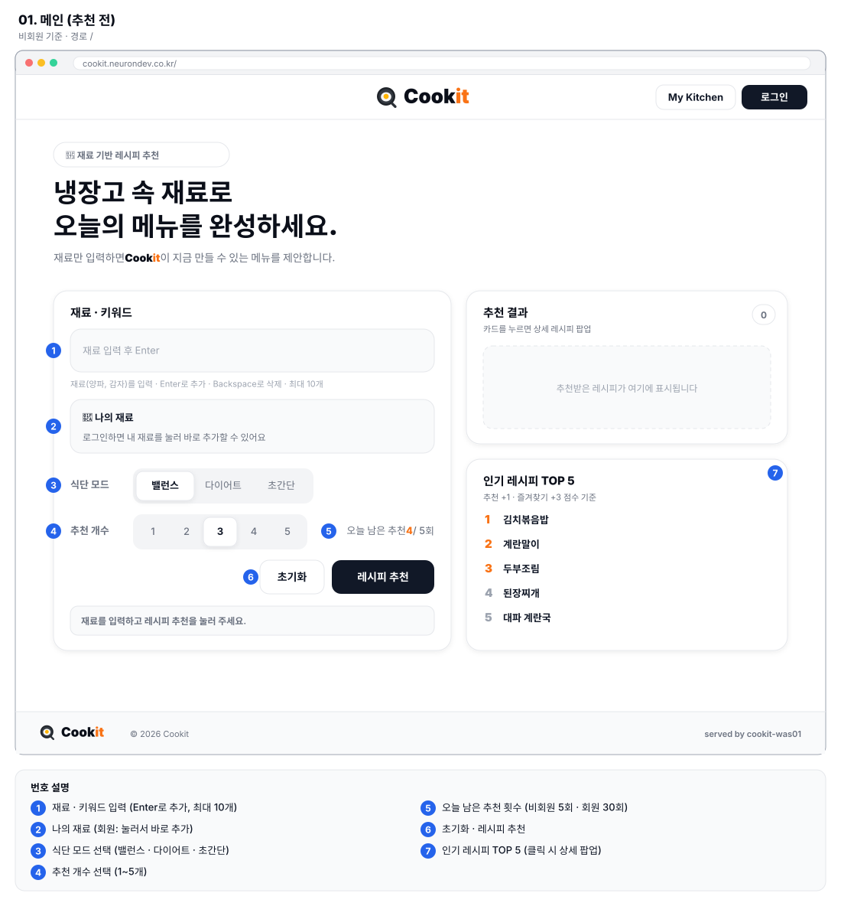

| 번호 | 요소 | 동작 | API |
|---|---|---|---|
| - | 소개 영역 | 서비스 한 줄 소개 ("냉장고 속 재료로 오늘의 메뉴를 완성하세요.") | - |
| 1 | 재료 · 키워드 | 입력 후 Enter로 재료 태그 추가, ✕·Backspace로 삭제. 최대 10개 | - |
| 2 | 나의 재료 | 회원: 내 재료가 태그로 표시, 누르면 입력 칸에 추가 / 비회원: "로그인하면 내 재료를 눌러 바로 추가할 수 있어요" | `GET /api/v1/ingredients` |
| 3 | 식단 모드 | 밸런스·다이어트·초간단 중 1개 선택 (기본 밸런스) | - |
| 4 | 추천 개수 | 1~5개 선택 (기본 3개) | - |
| 5 | 남은 횟수 | 오늘 남은 추천 횟수 표시 (비회원 5회, 회원 30회) | `GET /api/v1/recipes/limit` |
| 6 | 초기화·레시피 추천 | 초기화: 입력값 지움 / 레시피 추천: 재료 1개 이상일 때 활성화, 아래 안내 줄에 진행 상태 표시 | `POST /api/v1/recipes/recommend` |
| - | 추천 결과 | 오른쪽 카드에 결과 표시 (02 화면) | - |
| 7 | 인기 레시피 TOP 5 | 클릭 시 레시피 상세 팝업, Redis 장애로 조회 실패 시 영역 숨김 | `GET /api/v1/recipes/ranking` |

### 02. 메인 (추천 결과·상태)

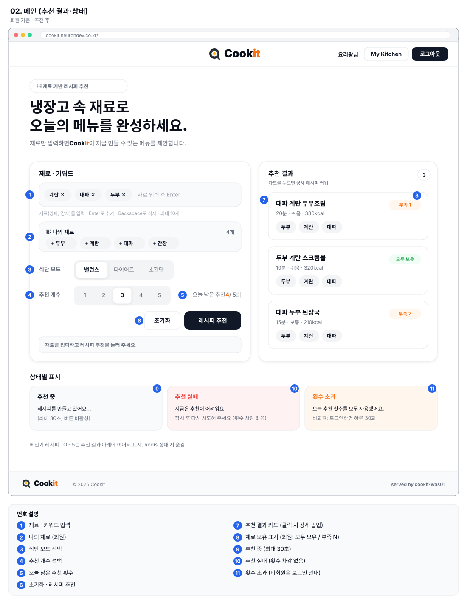

| 번호 | 요소 | 동작 | API |
|---|---|---|---|
| 1~6 | 입력 영역 | 01과 같음, 회원은 나의 재료 태그 표시 | - |
| 7 | 추천 결과 카드 | 제목, 조리 시간·난이도·칼로리, 필수 재료. 카드를 누르면 레시피 상세 팝업 | `GET /api/v1/recipes/{id}` |
| 8 | 재료 보유 표시 | 회원: 내 재료 기준 "모두 보유" 또는 "부족 N" 표시 / 비회원: 표시 없음 | - |
| 9 | 추천 중 | 진행 표시, 추천 버튼 비활성 (최대 30초) | - |
| 10 | 추천 실패 | Gemini 실패·시간 초과 안내, 추천 횟수 차감 안 함 | - |
| 11 | 횟수 초과 | 429 응답 시 안내, 비회원은 "로그인하면 하루 30회" 함께 표시 | - |

※ 인기 레시피 TOP 5는 추천 결과 아래에 이어서 표시, Redis 장애 시 숨김

### 03. 레시피 상세 팝업

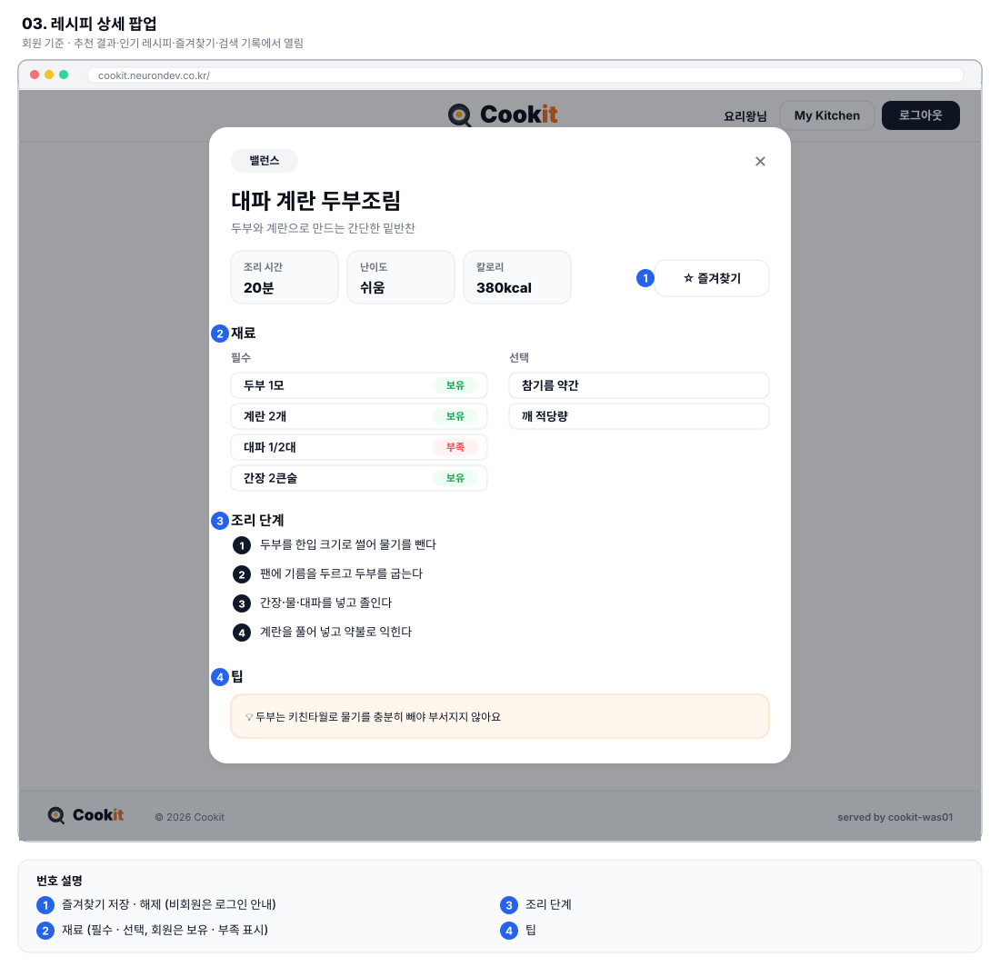

| 번호 | 요소 | 동작 | API |
|---|---|---|---|
| 1 | 즐겨찾기 | 회원: 저장·해제 전환 (☆ ↔ ★) / 비회원: 로그인 안내 | `POST /api/v1/favorites`, `DELETE /api/v1/favorites/{recipeId}` |
| 2 | 재료 | 위쪽에 식단 모드·조리 시간·난이도·칼로리 요약. 필수·선택 구분, 수량·단위 표시. 회원은 내 재료 기준 보유·부족 표시 (이름 비교, 공백 제거) | `GET /api/v1/recipes/{id}` |
| 3 | 조리 단계 | 순서대로 번호 표시 | - |
| 4 | 팁 | 강조 상자로 표시 | - |

※ 추천 결과·인기 랭킹·즐겨찾기·검색 기록에서 같은 팝업 사용

### 04. 로그인

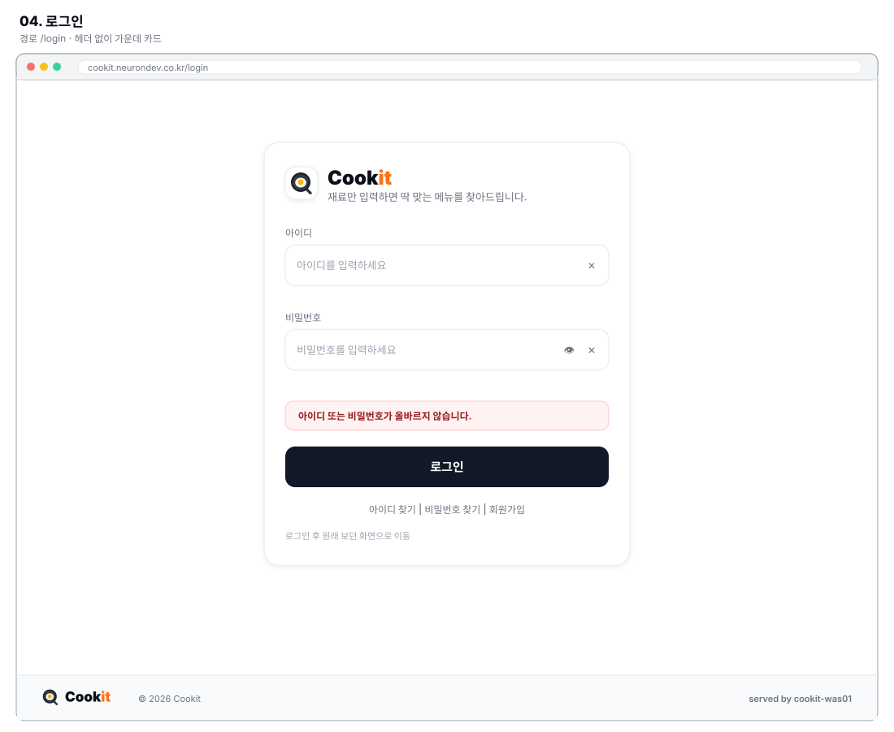

| 요소 | 동작 | API |
|---|---|---|
| 아이디·비밀번호 | 입력 후 로그인 (입력 칸에 지우기 ✕, 비밀번호 보기 👁), 실패 시 "아이디 또는 비밀번호가 올바르지 않습니다" (어느 쪽이 틀렸는지 알리지 않음) | `POST /api/v1/auth/login` |
| 링크 | 아이디 찾기, 비밀번호 찾기, 회원가입 | - |
| 로그인 후 | 원래 보던 화면으로 이동 (없으면 메인) | - |

### 05. 회원가입

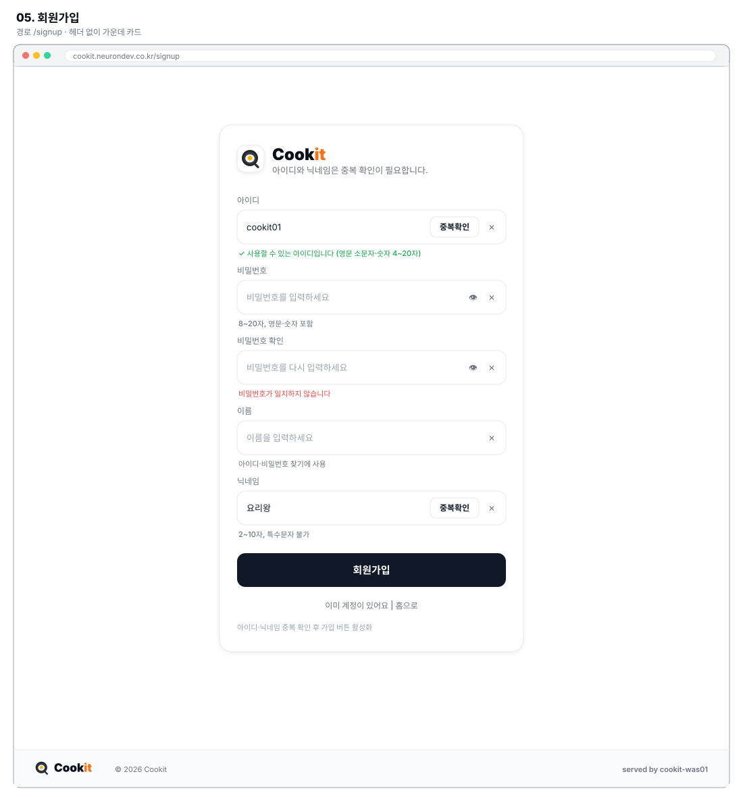

| 요소 | 규칙 | API |
|---|---|---|
| 아이디 | 영문 소문자·숫자 4~20자, [중복 확인] 필수 | `GET /api/v1/auth/check-id` |
| 비밀번호·확인 | 8~20자, 영문·숫자 포함, 확인 값과 일치 | - |
| 이름 | 1~50자, 아이디·비밀번호 찾기에 사용 | - |
| 닉네임 | 2~10자, 특수문자 불가, [중복 확인] 필수 | `GET /api/v1/auth/check-nickname` |
| 가입하기 | 중복 확인 완료 후 활성화, 가입 후 로그인 화면 이동 | `POST /api/v1/auth/signup` |

※ 중복 확인 후 값을 바꾸면 다시 확인 필요

### 06. 아이디 찾기

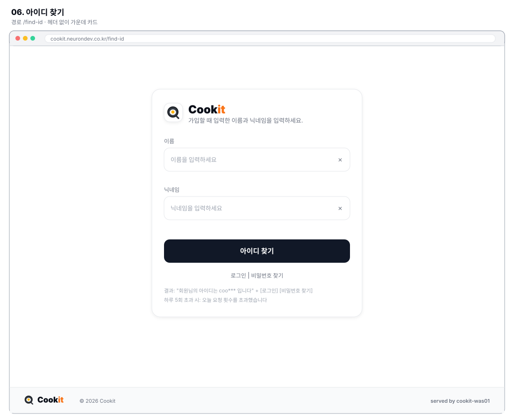

| 요소 | 동작 | API |
|---|---|---|
| 이름·닉네임 | 일치하는 회원의 아이디를 일부 가려서 표시 (예: coo***), 결과 아래 [로그인] [비밀번호 찾기] | `POST /api/v1/auth/find-id` |
| 제한 | IP당 하루 5회 초과 시 안내 | - |

### 07. 비밀번호 찾기

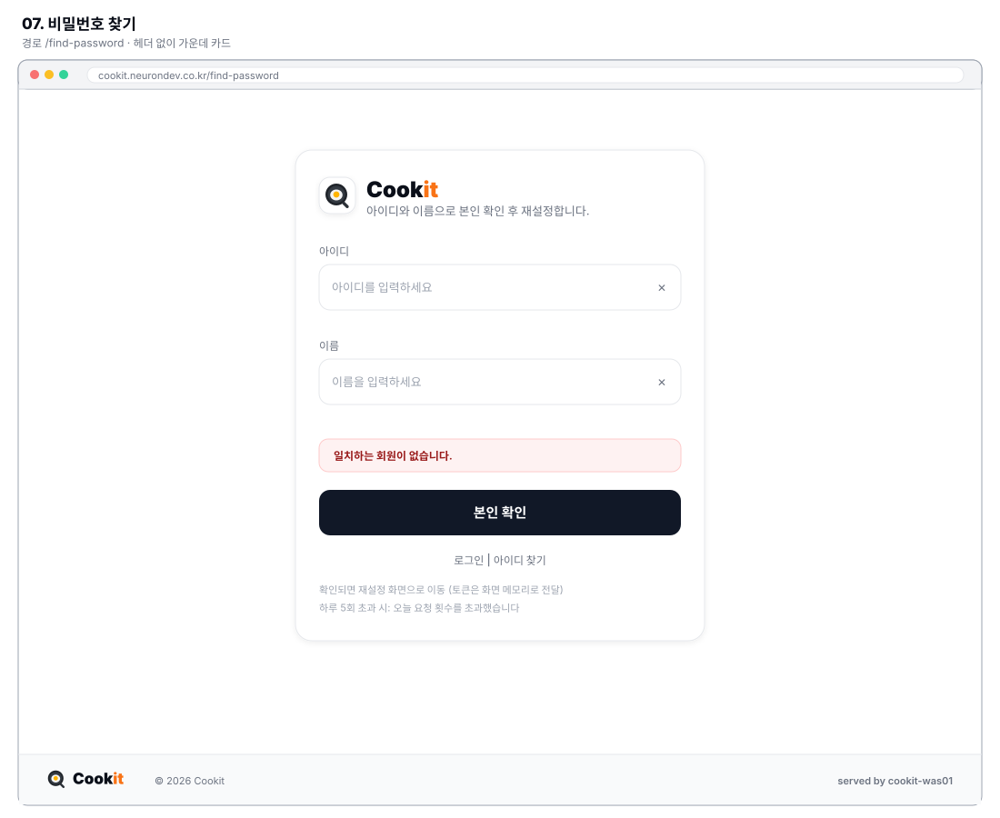

| 요소 | 동작 | API |
|---|---|---|
| 아이디·이름 | 본인 확인 성공 시 재설정 토큰을 받아 08 화면으로 이동 | `POST /api/v1/auth/password-reset` |
| 토큰 전달 | 화면 메모리(앱 상태)로만 전달, 주소창(URL)에 넣지 않음 (접속 기록·브라우저 기록에 남지 않게) | - |
| 제한 | IP당 하루 5회 초과 시 안내 | - |

### 08. 비밀번호 재설정

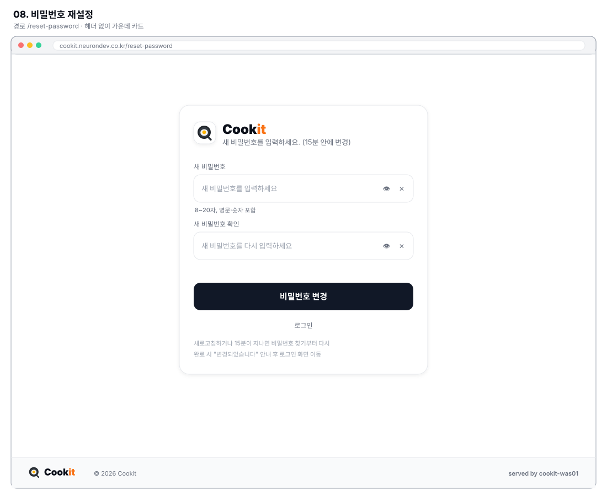

| 요소 | 동작 | API |
|---|---|---|
| 새 비밀번호·확인 | 회원가입과 같은 규칙, 변경 후 로그인 화면 이동 | `POST /api/v1/auth/password-reset/confirm` |
| 만료·새로고침 | 토큰 15분 만료, 새로고침하면 토큰이 사라져 07 화면부터 다시 | - |

### 09. My Kitchen > 내 재료

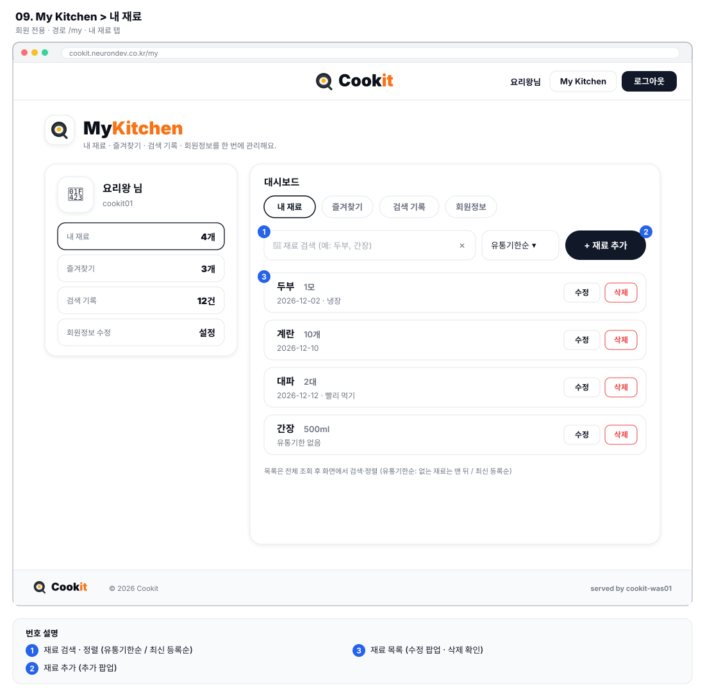

| 번호 | 요소 | 동작 | API |
|---|---|---|---|
| - | 화면 구성 | 왼쪽 프로필 카드(닉네임, 아이디, 내 재료·즐겨찾기·검색 기록 개수), 오른쪽 대시보드(탭 4개) | `GET /api/v1/users/me` |
| 1 | 검색·정렬 | 재료명 검색, 정렬(유통기한순: 없는 재료는 맨 뒤 / 최신 등록순). 목록 전체를 받아 화면에서 처리 | `GET /api/v1/ingredients` |
| 2 | 재료 추가 | 추가 팝업 열기 (09-1) | - |
| 3 | 재료 목록 | 재료명·수량·유통기한·메모. [수정] 팝업, [삭제] 확인 후 삭제 | `DELETE /api/v1/ingredients/{id}` |

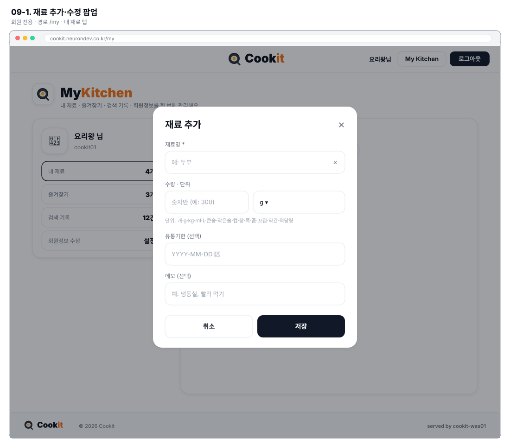

| 요소 | 동작 | API |
|---|---|---|
| 추가·수정 팝업 | 재료명(필수), 수량(숫자)·단위(선택 목록), 유통기한·메모(선택), 수정 시 기존 값 채움 | `POST /api/v1/ingredients`, `PUT /api/v1/ingredients/{id}` |

### 10. My Kitchen > 즐겨찾기

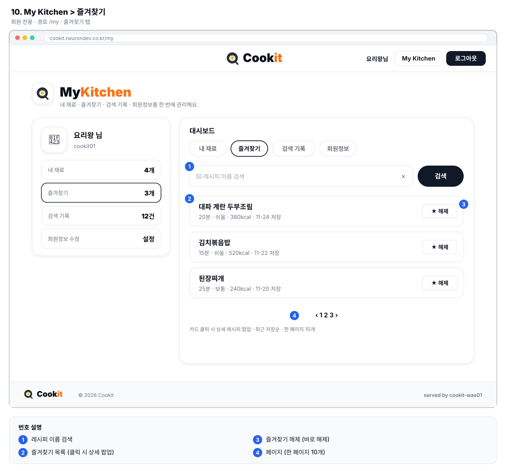

| 번호 | 요소 | 동작 | API |
|---|---|---|---|
| 1 | 검색 | 레시피 이름으로 검색 | `GET /api/v1/favorites?keyword=` |
| 2 | 목록 | 최근 저장 순, 클릭 시 레시피 상세 팝업 | `GET /api/v1/favorites` |
| 3 | 해제 | 바로 해제 (확인 팝업 없음), 목록에서 제거 | `DELETE /api/v1/favorites/{recipeId}` |
| 4 | 페이지 | 한 페이지 10개 | - |

### 11. My Kitchen > 검색 기록

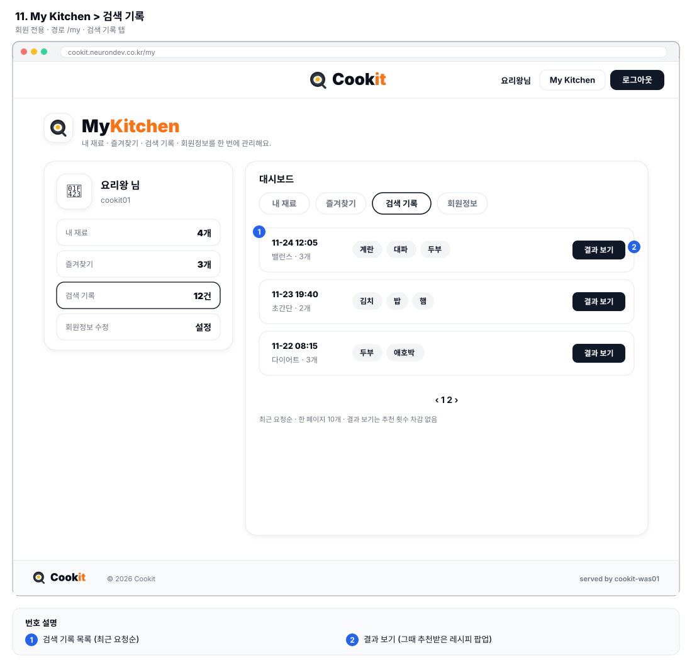

| 번호 | 요소 | 동작 | API |
|---|---|---|---|
| 1 | 기록 목록 | 요청 일시·입력 재료·식단 모드·추천 개수, 최근 요청 순, 한 페이지 10개 | `GET /api/v1/search-history` |
| 2 | 결과 보기 | 그때 추천받은 레시피 목록 팝업 열기 (추천 횟수 차감 없음) | `GET /api/v1/search-history/{id}` |

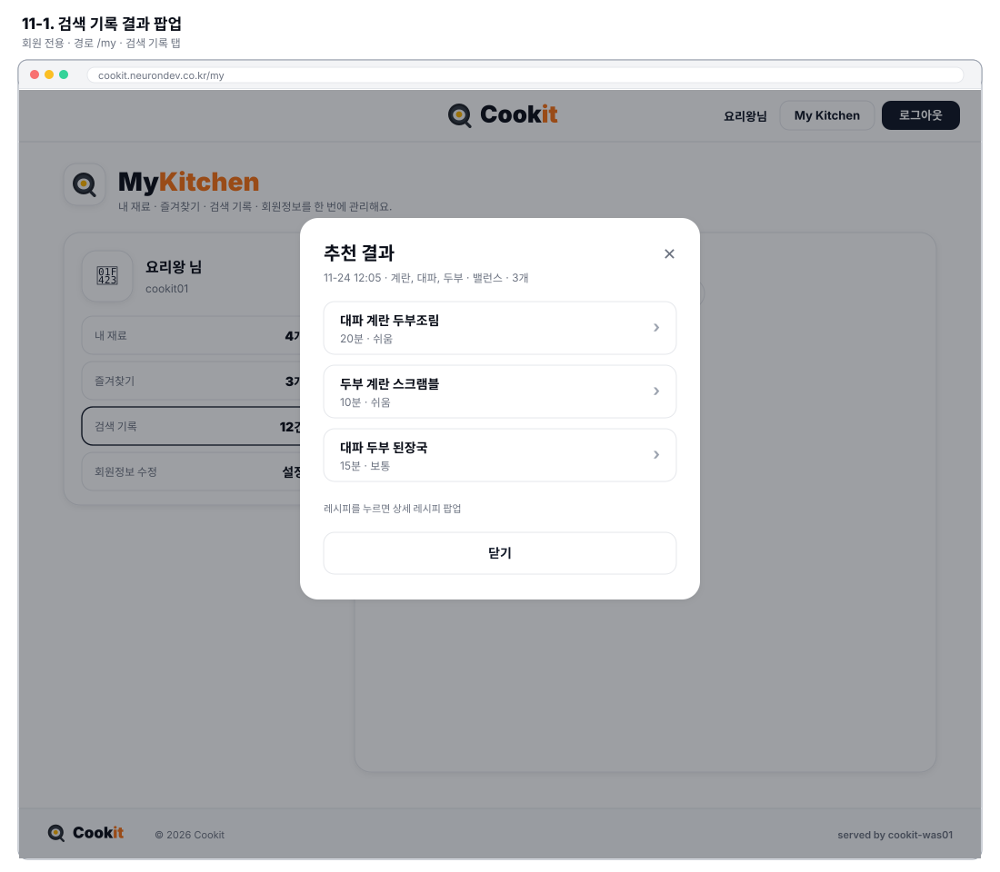

| 요소 | 동작 | API |
|---|---|---|
| 결과 팝업 | 요청 조건 요약, 레시피 목록. 레시피를 누르면 레시피 상세 팝업 | `GET /api/v1/recipes/{id}` |

### 12. My Kitchen > 회원정보

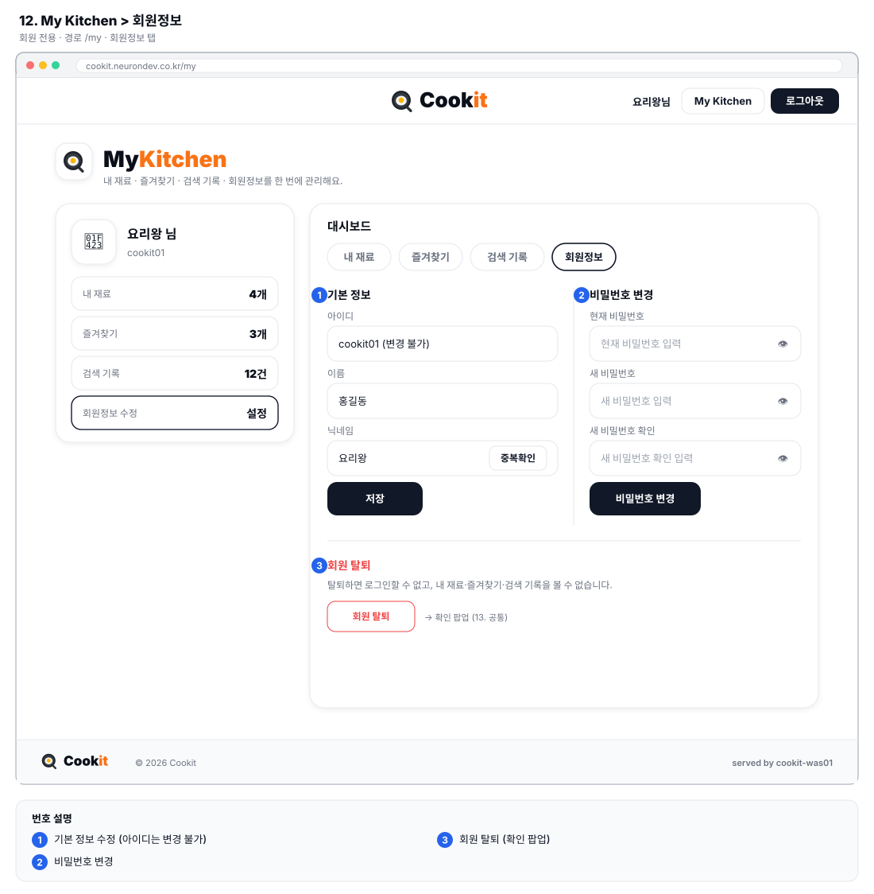

| 번호 | 요소 | 동작 | API |
|---|---|---|---|
| 1 | 기본 정보 | 아이디(변경 불가), 이름·닉네임 수정 (닉네임 변경 시 중복 확인) | `GET /api/v1/users/me`, `PUT /api/v1/users/me` |
| 2 | 비밀번호 변경 | 현재 비밀번호 확인 후 변경 | `PUT /api/v1/users/me/password` |
| 3 | 회원 탈퇴 | 확인 팝업 → 탈퇴 → 로그아웃 후 메인 이동 | `DELETE /api/v1/users/me` |

### 13. 공통 요소

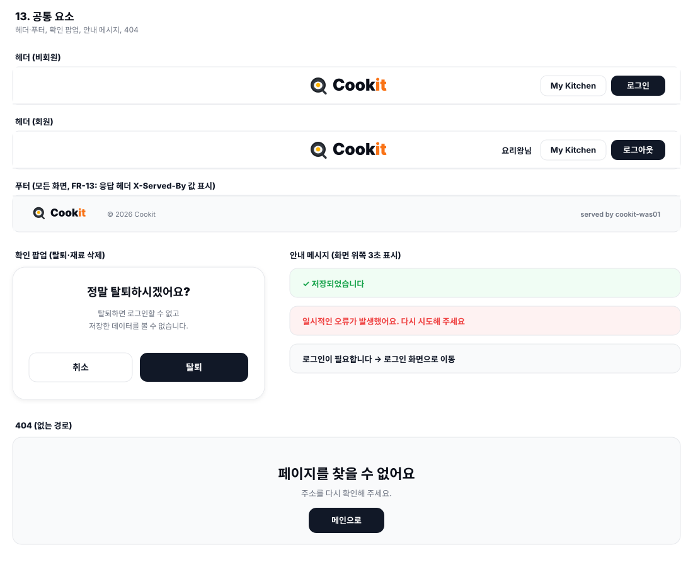

| 요소 | 내용 |
|---|---|
| 헤더 | 가운데 로고. 비회원: My Kitchen(누르면 로그인 안내)·로그인 / 회원: 닉네임, My Kitchen, 로그아웃 |
| 푸터 | 로고, 저작권 표시, `served by cookit-was01` (응답 헤더 `X-Served-By` 값, FR-13) |
| 확인 팝업 | 탈퇴·재료 삭제 등 되돌릴 수 없는 동작 전 표시 |
| 안내 메시지 | 성공·오류·로그인 필요 안내 (3초 표시) |
| 404 | 없는 경로 접속 시 안내, [메인으로] |

## 4. 모바일

| 화면 | 와이어프레임 | 차이점 |
|---|---|---|
| M1. 메인 | 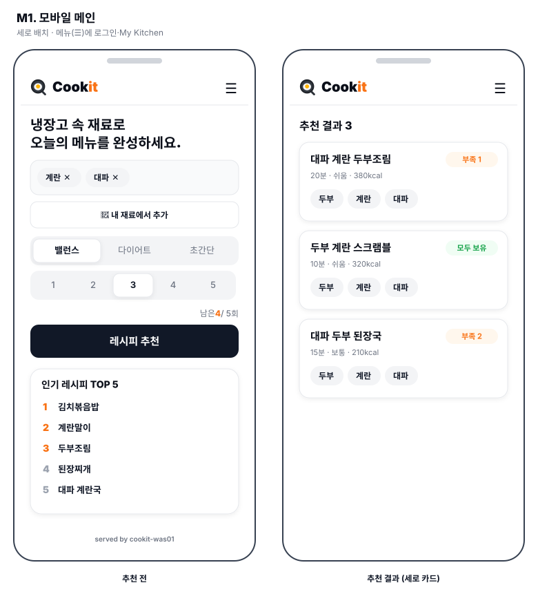 | 세로 배치, 나의 재료는 버튼으로 열기, 추천 결과는 세로 카드 목록, 로그인·My Kitchen은 메뉴(☰) |
| M2. 레시피 상세 | 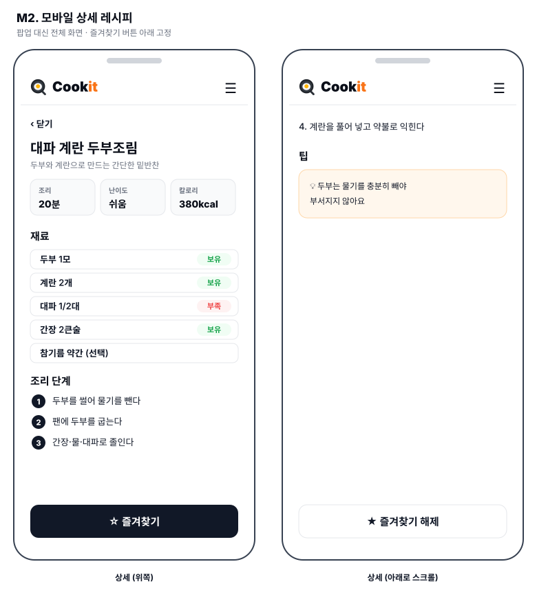 | 팝업 대신 전체 화면, 즐겨찾기 버튼 아래 고정 |
| M3. My Kitchen | 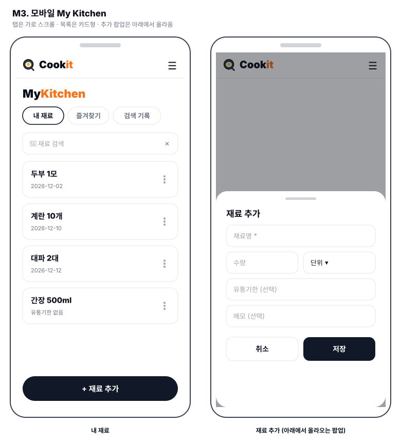 | 프로필 카드 생략, 탭 가로 스크롤, 목록은 카드형, 추가 팝업은 아래에서 올라오는 형태 |

※ 나머지 화면(로그인, 회원가입 등)은 입력칸이 세로로 늘어서는 정도라 별도 와이어프레임 생략
